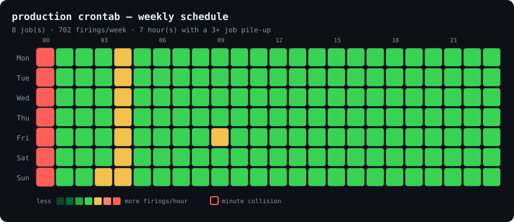

# cronscope

[](https://github.com/RootX22/cronscope/actions/workflows/ci.yml)
[](LICENSE)


**See inside your crontab.** cronscope predicts when jobs actually run, catches
the mistakes that cause silent incidents, and renders the whole week as a
heatmap so you can *see* the midnight stampede instead of discovering it in a
load graph.

**[Try it in your browser](https://rootx22.github.io/cronscope/)**: paste a crontab
and see its week. It runs cronscope itself through Pyodide, so nothing you paste
leaves the page.

<p align="center">
  
</p>

That red column is three backup jobs and a health check all firing at `00:00`,
every day. You would never spot it reading the crontab top to bottom. It jumps
out of the picture.

## Why

Cron is where scheduling goes to fail quietly. There is no error when a job
never runs, no warning when two heavy jobs collide, and one of the most common
expressions does something almost nobody expects. cronscope surfaces all three.

**The day-of-month / day-of-week trap.** This is the big one:

```console
$ cronscope --explain "0 0 13 * 5"
  0 0 13 * 5
  note: day-of-month AND day-of-week are both set — runs on EITHER
  next 4 run(s):
    Fri 2026-09-04 00:00
    Fri 2026-09-11 00:00
    Sun 2026-09-13 00:00     ← the 13th, a Sunday
    Fri 2026-09-18 00:00
```

`0 0 13 * 5` does **not** mean "Friday the 13th". When both day fields are set,
cron fires when *either* matches — so this runs every Friday **and** on the 13th
of every month. cronscope tells you, and its next-run predictions prove it.

## Install

```bash
pip install git+https://github.com/RootX22/cronscope.git
```

Or run it from a clone — **no runtime dependencies**, standard library only:

```bash
git clone https://github.com/RootX22/cronscope.git
crontab -l | python3 -m cronscope -
```

## Usage

```bash
crontab -l | cronscope -                    # lint your live crontab
cronscope /etc/crontab --system             # a system crontab (user column)
cronscope --explain "*/15 9-17 * * 1-5"     # decode one expression + next runs
cronscope mycron --svg week.svg             # render the weekly heatmap
cronscope mycron --json                     # machine-readable, for CI
```

| Flag | Meaning |
|---|---|
| `--explain EXPR` | Decode one expression and show its next runs |
| `--next N` | How many upcoming runs to show (default 5) |
| `--svg OUT` | Write the weekly heatmap SVG (`-` for stdout) |
| `--system` | Parse a system crontab (leading user column) |
| `--json` | Lint results as JSON |
| `--fail-on` | `info` / `warning` / `error` / `never` (default `error`) |

**Exit codes:** `0` clean, `1` issues at or above `--fail-on` (or a parse error),
`2` usage error. Drop it in CI to fail a deploy when someone commits a broken
schedule.

## What it catches

| Rule | Level | What it means |
|---|---|---|
| `never-runs` | error | The schedule has no valid fire time — a day-of-month that cannot occur in the month (`Feb 30`, `Apr 31`). The job silently never runs. |
| `dom-dow-or` | warning | Both day fields set — runs on *either*, not both. The Friday-the-13th trap. |
| `collision` | warning | Three or more jobs fire in the same minute, stacking their load. The midnight stampede. |
| `percent-literal` | warning | An unescaped `%` — cron turns it into a newline and feeds the rest to stdin, breaking `date +%Y`. |
| `every-minute` | info | Runs 1440×/day. Fine for some jobs, a resource risk for heavy ones. |
| `no-redirect` | info | Output isn't redirected, so cron emails it — noise, or a leak. |

## The heatmap

`--svg` writes a self-contained SVG (no external fonts, no scripts, renders
anywhere) showing a reference week:

- **cell heat** — how many job firings land in that hour, cool → hot
- **red ring** — three or more jobs firing in the *same minute*, a real load spike

Density is the honest encoding: it does not fall apart when one job runs every
15 minutes, and "where is it hot" is exactly the question the picture answers.
Commit it to a repo, drop it in a runbook, paste it in a review.

## As a library

```python
from datetime import datetime
from cronscope import parse_crontab, lint
from cronscope.expression import CronExpression

# next runs of a single expression
CronExpression.parse("0 3 * * 1-5").next_runs(datetime.now(), 3)

# lint a whole crontab
ct = parse_crontab(open("/etc/crontab").read(), system=True)
for issue in lint(ct):
    print(issue.level.label, issue.line_no, issue.message)
```

## Correctness

The next-run computation is the heart of the tool, so it is pinned against
hand-verified datetimes — the OR rule, Sunday-as-`0`-or-`7`, named months and
weekdays, leap-day resolution (`Feb 29` → the next leap year), and impossible
schedules returning `None`. If cronscope says a job runs at a time, it runs at
that time.

## Scope

cronscope reads and reasons about crontab *text*. It does not install, edit, or
run anything — point it at `crontab -l`, a file, or stdin. It models standard
Vixie/POSIX cron (5 fields, `@macros`, `@reboot`, names, ranges, steps, lists).
Non-standard extras some daemons add (seconds fields, `L`/`W`/`#` in day fields)
are not modelled yet — see the issues.

## Licence

MIT
